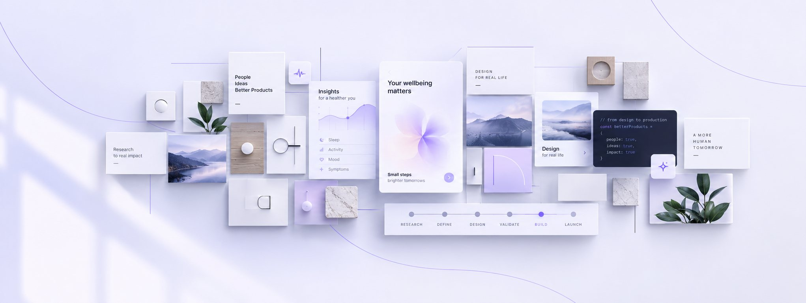

# Olesya Levytska — Product Design Portfolio

[](https://github.com/olesyalevytskaua-ops/olesya_levytska_ui-ux/actions/workflows/site-tests.yml)

**Complex products. From discovery to delivery.**

A personal portfolio designed and built by **Olesya Levytska**, Senior Product & UX/UI Designer working across healthcare, AI-powered products and SaaS.

[Visit the portfolio](https://olesyalevytskaua-ops.github.io/olesya_levytska_ui-ux/) · [Read the build story](https://olesyalevytskaua-ops.github.io/olesya_levytska_ui-ux/case-portfolio.html) · [View CV](https://olesyalevytskaua-ops.github.io/olesya_levytska_ui-ux/cv.html)



## My role

**Sole designer and builder:** information architecture, visual direction, content, responsive implementation, review and publication. I use Claude, Cursor and ChatGPT as development collaborators; design decisions and responsibility for the finished site remain mine.

This ownership applies to the portfolio website. Commercial case studies describe my contribution within their respective teams; they do not claim sole ownership of those products.

## At a glance

| Scope | Verified count |
| --- | --- |
| Core pages | 6 — Home, Work, About, Insights, CV, Contact |
| Product case studies | 13 — excluding the portfolio build story |
| Colour themes | 2 — light and dark |
| Frontend frameworks | 0 — plain HTML, CSS and JavaScript |

Snapshot: **16 November 2026**. These figures describe the build, not traffic, conversion or independently audited accessibility results.

## What the site demonstrates

- Product stories connecting research, analytics and design decisions to delivery.
- Independent experiments alongside professional healthcare and SaaS work.
- Responsive layouts, keyboard-focus styles and reduced-motion alternatives.
- Theme-aware interface patterns and a downloadable three-page CV.
- AI-assisted implementation reviewed and maintained through GitHub branches and pull requests.

## Design approach

The portfolio provides a consistent editorial frame: navigation, typography, spacing and reusable components. Product-specific colours, interface screens and artwork may differ inside a case to represent that product’s identity. Those differences should not replace the portfolio’s shared navigation or compromise readability.

Follow [the design-system rules](DESIGN-SYSTEM-RULES.md) when updating components and interactions. Accessibility features are implemented, but no full independent WCAG audit is claimed.

## Stack and local preview

The site is served directly from `docs/` with **GitHub Pages**. No frontend build step is required.

```sh
npm install
npm run serve        # http://localhost:4173
```

Optional Node tooling supports image optimisation; Python tooling builds the downloadable CV.

## Tests

Every pull request runs the same checks in GitHub Actions:

| Command | What it checks |
| --- | --- |
| `npm run test:html` | Valid, semantic HTML on every page ([html-validate](https://html-validate.org)) |
| `npm run test:links` | Every internal link, image and anchor points to something that exists |
| `npm run test:browser` | Each page on desktop and mobile, light and dark: no JS errors, no broken assets, no sideways scrolling, no serious axe-core accessibility violations (WCAG 2.2 AA rules); plus theme toggle, navigation, contact dialog and the mobile CV shortcut |

Run everything with `npm test` (first time: `npx playwright install chromium`).

## Project structure

```text
docs/                    Published HTML, CSS, JavaScript and assets
docs/case-portfolio.html Portfolio build story
docs/cv.html             Website CV
tests/                   HTML, link, browser and accessibility tests
scripts/build_cv_3pages.py PDF CV generator
DESIGN-SYSTEM-RULES.md   Shared interaction and accessibility conventions
```

## Publishing and maintenance

GitHub Pages serves `main` → `/docs`. Keep changes scoped and review them before merging. Changes to the CV generator trigger the existing PDF-publishing workflow.

Automated tests cover links, assets, both themes and mobile reflow; before release, also check keyboard navigation and reduced motion by hand. Automated accessibility checks catch many issues but are not a full WCAG audit.

## Credits and reuse

Design, portfolio content and implementation ownership: **Olesya Levytska**. Client names and product imagery remain attributable to their respective owners. Please ask before reusing portfolio text or visual assets.
